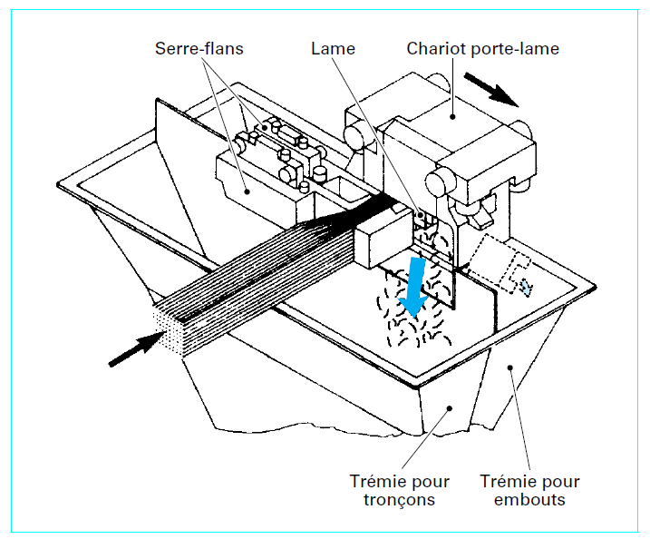

\vspace{-5em}

{width=100%}

# Contexte

Dans les procédés de l'aval du cycle du combustible, la préparation mécanique des combustibles usés constitue une étape clé en amont des opérations de traitement et de valorisation des matières.
Le cisaillage en est une opération centrale : il consiste à fragmenter les assemblages combustibles en tronçons de dimensions maîtrisées afin de faciliter leur prise en charge par les étapes ultérieures du procédé.
Les technologies de cisaillage actuellement utilisées ont été conçues et éprouvées pour les assemblages classiques des réacteurs à eau sous pression et à eau bouillante, respectivement de types PWR et BWR, dont les géométries et les caractéristiques mécaniques sont bien connues.
Toutefois, le développement des réacteurs nucléaires de quatrième génération, et notamment des réacteurs à neutrons rapides refroidis au sodium (RNR-Na), introduit des assemblages combustibles présentant des spécificités susceptibles de modifier leur comportement lors de la coupe.
Leur géométrie, la nature et l'épaisseur des matériaux constitutifs ainsi que leur comportement mécanique après irradiation imposent ainsi de réévaluer et, si nécessaire, d'adapter l'étape de cisaillage.

{#fig-cisaille width="50%"}

L'objectif de l'étude sera d'évaluer la capacité de la technologie de cisaillage actuelle à traiter un assemblage combustible RNR-Na, par la simulation numérique du procédé.
Les résultats permettront d'anticiper la faisabilité du cisaillage avec les équipements existants et, si nécessaire, d'orienter des évolutions de l'outillage ou de la conception de l'assemblage.

# Objectif scientifique du stage

L'objectif scientifique du stage consistera à mettre en place une première base de simulation numérique du procédé de cisaillage d'un assemblage combustible RNR-Na.
Une simulation complète de l'assemblage étant hors de portée à l'échelle d'un stage, l'étude se concentrera sur la modélisation du cisaillage d'un crayon de combustible.
Le travail consistera notamment à :

* construire un modèle par éléments finis du crayon, et, si besoin, de l'outil de coupe,
* représenter le comportement mécanique des matériaux, y compris leur non-linéarité,
* simuler la coupe du crayon par la cisaille, afin d'analyser les efforts générés ainsi que les modes de déformation et de rupture.

La modélisation 3D ainsi développée servira de référence pour identifier les paramètres et les phénomènes déterminants pour la coupe.
Elle sera ensuite mobilisée dans le cadre d'une étude paramétrique visant à formuler un modèle simplifié de crayon, dont le coût de calcul réduit permettra d'envisager la simulation d'un assemblage complet.

# Informations complémentaires

## Profil recherché

Candidat.e en Master 2 en mécanique des solides et des structures, avec un intérêt pour :

* la modélisation du comportement des matériaux, plus spécifiquement l'endommagement et la rupture,
* la simulation numérique de structures mécaniques, notamment par éléments finis,
* les applications au domaine nucléaire.

Des compétences en calcul de structures et en programmation scientifique (Python) seraient un plus.

## Modalités

Le stage est proposé pour une durée de 5 à 6 mois, sur la période février-août 2027.

La période exacte pourra être ajustée en fonction des contraintes académiques de la personne retenue.

Le stage sera rémunéré conformément à la gratification légale en vigueur.

## Partenaires

Ce stage est proposé dans le cadre d'une collaboration entre le LaMCoS (UMR 5259, INSA Lyon / CNRS) et la direction R&D du groupe Orano.

## Contact

* Flavien Loiseau (LaMCoS, INSA Lyon) : [flavien.loiseau@insa-lyon.fr](mailto:flavien.loiseau@insa-lyon.fr?subject=[LaMCoS-Orano] Stage M2 Cisaillage combustible RNR-Na : Candidature PRENOM NOM).

## Candidature

Les candidatures se font par e-mail, avec l'objet « **\[LaMCoS-Orano\] Stage M2 Cisaillage combustible RNR-Na : Candidature PRENOM NOM** », et doivent comporter :

* un CV,
* une lettre de motivation,
* les relevés de notes de M1,
* une lettre de recommandation.

Les candidatures seront examinées au fil de leur réception.
